# Multi-Cancer Image Classification with Neural Networks and Genetic Algorithms

**Student:** Mehmet Yusuf Ocak — Erasmus<br>
**Course:** Neural Networks and Genetic Algorithms<br>
**Institution:** National University of Science and Technology POLITEHNICA Bucharest<br>
**Project type:** Educational image-classification research project

This repository contains a reproducible study of the Kaggle **Multi Cancer** image dataset. The
system predicts one of **26 detailed dataset leaf classes** and then deterministically maps that
prediction to one of the dataset's **eight parent groups**. The work includes a full dataset audit,
duplicate/leakage analysis, a fixed known-family-grouped split, controlled neural-network
experiments, error analysis, Grad-CAM explainability, and an equal-budget genetic-algorithm versus
random-search comparison.

> This project evaluates classification within the supplied dataset. It is not a clinically
> validated diagnostic system, does not predict a universal cancer/no-cancer label, and does not
> predict cancer stage.

## Project at a glance

| Item | Verified value |
|---|---:|
| Accepted images | 130,000 |
| Parent dataset groups | 8 |
| Detailed leaf classes | 26 |
| Images per leaf | 5,000 |
| Fixed train / validation / test | 91,000 / 19,500 / 19,500 |
| Best test leaf accuracy | **99.6462%** |
| Best test leaf macro-F1 | **99.6462%** |
| Best derived-parent accuracy | **99.9897%** |
| Best-model leaf errors | 69 / 19,500 |
| Exact duplicate groups | 1,318 |
| Cross-split known-family components | 0 |

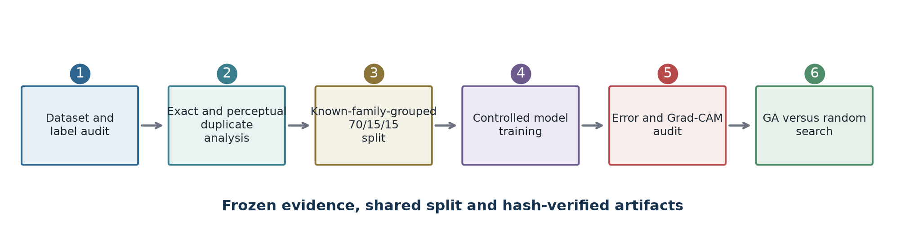

## Main contribution

The downloaded dataset is already augmented, while filenames do not preserve patient, series, or
original-image family identifiers. A naive random image-level split could therefore place exact or
visually related files on both sides of the evaluation. The project addressed this risk before
training:

1. Audited all 130,000 accepted images and their metadata.
2. Detected byte-identical files with SHA-256.
3. Developed and tested a modality-aware near-duplicate workflow using pHash, robust ResNet18
   retrieval, ORB/RANSAC, phase correlation, ECC, SSIM, NMI, correlation, and blinded visual
   review.
4. Merged every known exact or reviewed relationship into transitive components.
5. Assigned each component wholly to train, validation, or test.
6. Reused the exact same saved split for every reportable model.

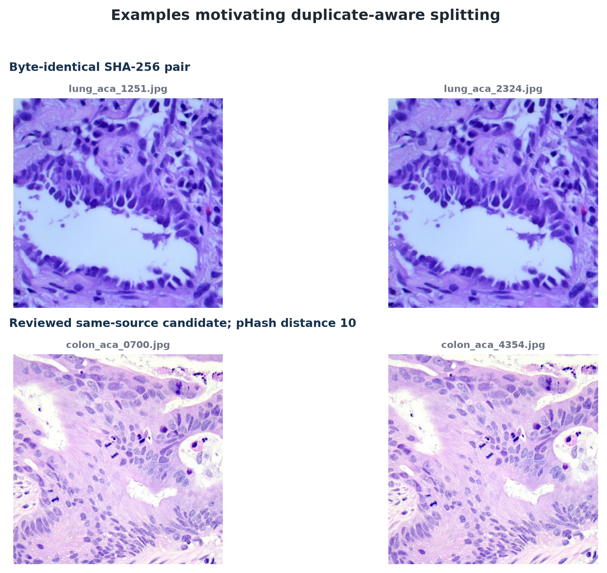

## Dataset and task definition

The eight top-level folders are heterogeneous dataset/source groups rather than eight uniform
cancer diagnoses. They combine blood-smear microscopy, contrast-enhanced brain MRI, abdominal CT,
Pap-smear microscopy, and several histopathology collections.

| Parent group | Leaf labels | Images |
|---|---|---:|
| ALL | `all_benign`, `all_early`, `all_pre`, `all_pro` | 20,000 |
| Brain Cancer | `brain_glioma`, `brain_menin`, `brain_tumor` | 15,000 |
| Breast Cancer | `breast_benign`, `breast_malignant` | 10,000 |
| Cervical Cancer | `cervix_dyk`, `cervix_koc`, `cervix_mep`, `cervix_pab`, `cervix_sfi` | 25,000 |
| Kidney Cancer | `kidney_normal`, `kidney_tumor` | 10,000 |
| Lung and Colon Cancer | `colon_aca`, `colon_bnt`, `lung_aca`, `lung_bnt`, `lung_scc` | 25,000 |
| Lymphoma | `lymph_cll`, `lymph_fl`, `lymph_mcl` | 15,000 |
| Oral Cancer | `oral_normal`, `oral_scc` | 10,000 |

The model is trained directly on the 26 leaf labels. The eight-parent result is derived from the
predicted leaf; it is not produced by a separate model. This preserves the detailed target while
also providing the professor-requested eight-group evaluation.

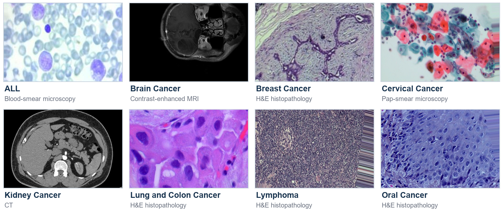

See [Dataset Taxonomy](docs/DATASET_TAXONOMY.md) for the full semantic interpretation and safe
wording for every leaf.

## Data audit and fixed split

The audit accepted 130,000 images after excluding two `*.bak.jpg` files. All accepted images open
successfully. A content-header inspection found 125,000 JPEG-encoded images and 5,000 PNG-encoded
`breast_malignant` images stored with `.jpg` names. Three images are 640×640; all others are
512×512. The loader decodes by file content and resizes without altering source files.

SHA-256 analysis found **1,318 exact-duplicate groups**, containing 2,673 files and 1,355 redundant
copies. No exact group crossed a leaf label. Exact groups and 85 frozen reviewed links were merged
transitively into:

- 128,560 total components;
- 1,402 multi-image components;
- 2,842 images inside multi-image components;
- maximum component size of four.

The final fixed split is exactly stratified at leaf level:

- 3,500 train images per leaf;
- 750 validation images per leaf;
- 750 test images per leaf;
- zero cross-split exact groups;
- zero cross-split reviewed links;
- zero cross-split known-family components.

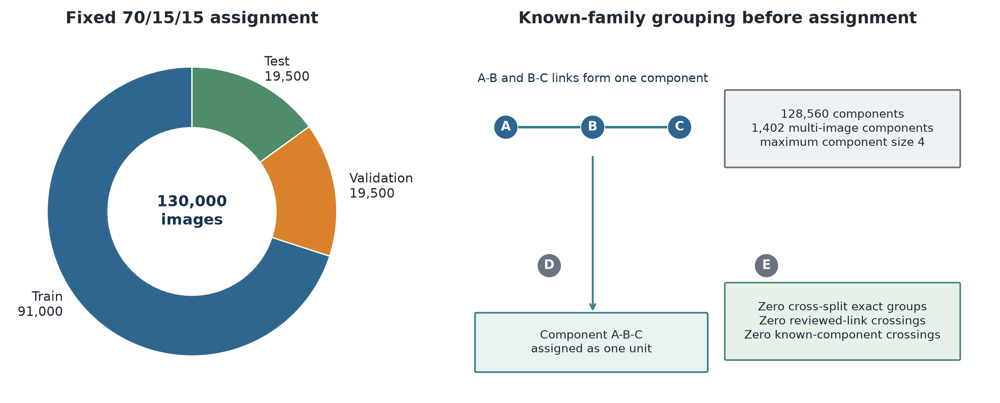

The authoritative manifest is
[`research/splits/practical_leakage_reduced_split_v1.csv`](research/splits/practical_leakage_reduced_split_v1.csv),
SHA-256 `999bf7a9bd1bba9f2957a9db0e13ae72adb3ecb8fdbc1f33cce40b083c1cf171`.

The valid claim is **known-family-grouped, practical leakage-reduced split**. Patient-level or
complete unknown-near-duplicate separation cannot be claimed because the dataset does not provide
patient or scan-series identifiers.

## Neural-network experiments

All reportable runs used the same split, seed 42, 224×224 inputs, validation macro-F1 checkpoint
selection, and the identical 19,500-image test set.

| Model | Training strategy | Best epoch | Leaf accuracy | Leaf macro-F1 | Parent accuracy |
|---|---|---:|---:|---:|---:|
| ResNet18 | ImageNet backbone frozen; new classifier head | 9 | 91.3026% | 91.2455% | 99.7744% |
| SmallCNN | Approximately 97k parameters, trained from scratch | 25 | 95.5846% | 95.5916% | 99.9231% |
| **ResNet18** | **Prior best checkpoint; train `layer4 + fc`** | **11** | **99.6462%** | **99.6462%** | **99.9897%** |
| GA-selected ResNet18 | Equal-budget GA hyperparameters | 10 validation | 99.5795% | 99.5794% | 99.9846% |
| Random-selected ResNet18 | Equal-budget random-search hyperparameters | 11 validation | 99.5744% | 99.5745% | 99.9795% |

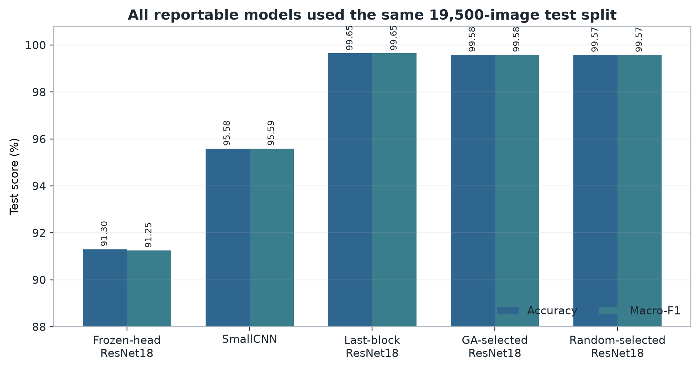

The manually configured last-block fine-tuned ResNet18 remains the strongest test result. Its
19,500 test predictions contain 19,431 correct leaf predictions and 69 leaf errors. Sixty-seven
of those leaf errors remain inside the correct parent group, explaining why parent accuracy is
higher than leaf accuracy.

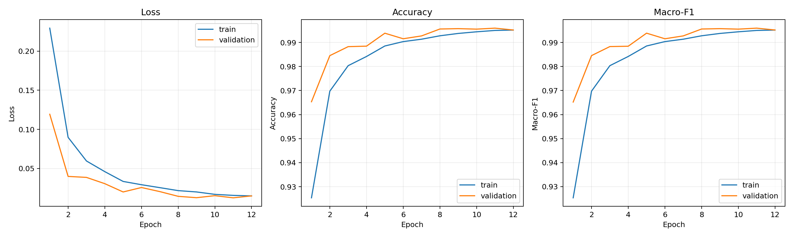

## Best-model evidence

The repository includes the following visual and machine-readable evidence:

- [Representative correct and incorrect predictions](research/final_report/figures/17_prediction_examples.png)
- [26-leaf confusion matrix](research/final_report/figures/11_best_leaf_confusion_matrix.png)
- [Eight-parent confusion matrix](research/final_report/figures/12_best_parent_confusion_matrix.png)
- [All 69 error rows](research/model_results/resnet18_lastblock_finetune_v1/error_analysis_v1/error_rows.csv)
- [Twelve error contact sheets](research/model_results/resnet18_lastblock_finetune_v1/error_analysis_v1/contact_sheets/)
- [Best-model test metrics](research/model_results/resnet18_lastblock_finetune_v1/test_metrics.json)
- [Training history](research/model_results/resnet18_lastblock_finetune_v1/history.csv)

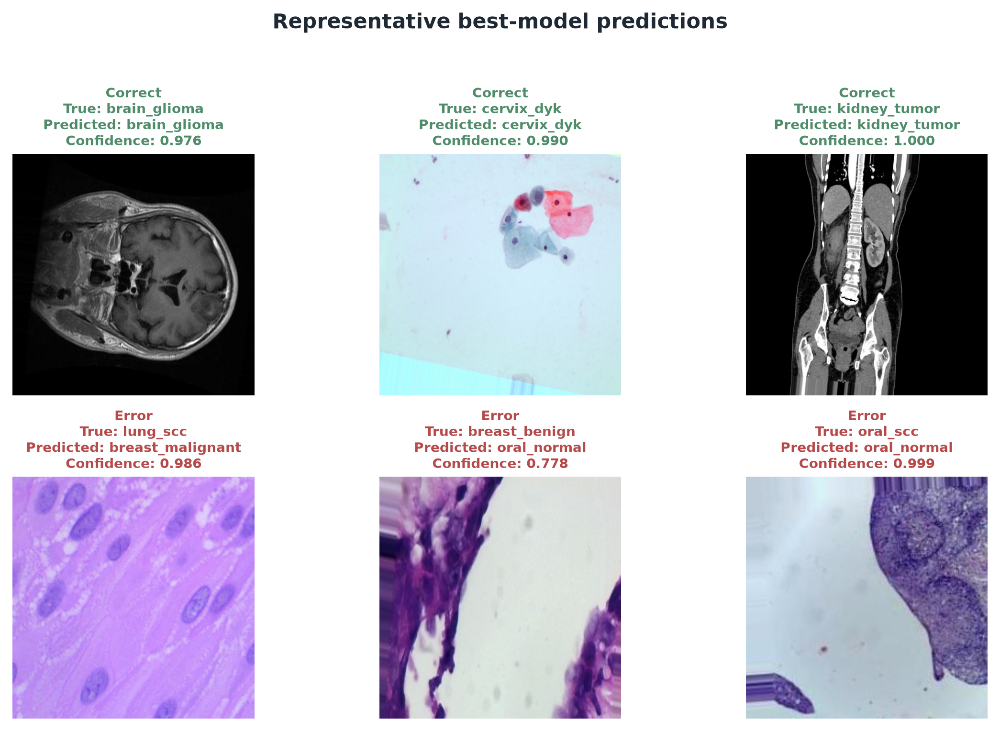

## Error and confidence analysis

The most frequent leaf confusion was oral normal versus oral SCC: 18
`oral_normal → oral_scc` and 16 `oral_scc → oral_normal` errors. Only two errors crossed parent
groups. The post-hoc test audit also measured:

| Measure | Value |
|---|---:|
| 15-bin expected calibration error | 0.001032 |
| Negative log-likelihood | 0.010893 |
| Multiclass Brier score | 0.005630 |
| Top-2 accuracy | 99.9949% |

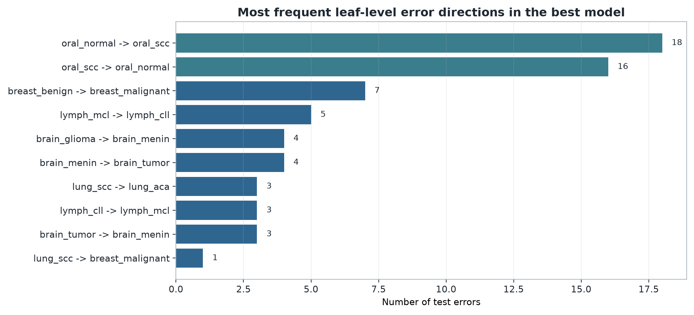

## Grad-CAM explainability audit

Before generating heatmaps, 37 test samples were frozen: one correct control for every leaf and 11
predefined error cases. The final checkpoint reproduced all 37 predictions. Grad-CAM was computed
at `layer4.1.conv2`, producing 37 panels and seven contact sheets.

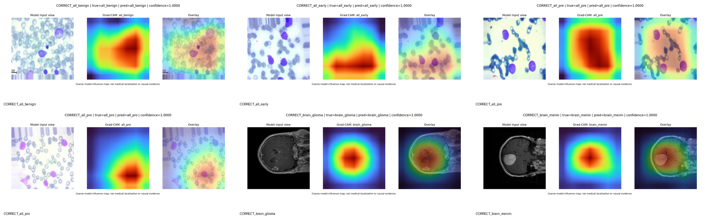

Grad-CAM identifies coarse regions that influence a class score. It is not object detection,
pathologist annotation, causal evidence, or proof that a highlighted region is malignant. The
complete evidence is in
[`research/model_results/resnet18_lastblock_finetune_v1/gradcam_v1/`](research/model_results/resnet18_lastblock_finetune_v1/gradcam_v1/).

## Genetic algorithm experiment

The genetic algorithm optimized three ResNet18 hyperparameters while keeping model architecture,
initial checkpoint, data, seed, and compute budget fixed:

- learning rate: `1e-5` to `3e-4`, log scale;
- weight decay: `1e-6` to `1e-3`, log scale;
- dropout: `0.10` to `0.50`.

GA and random search each received 12 unique candidates and four proxy epochs per candidate. The
proxy contained 9,100 train and 3,900 validation images, with no test access. Their two winners
were then confirmed on all 91,000 training and 19,500 validation paths before a single shared-test
evaluation.

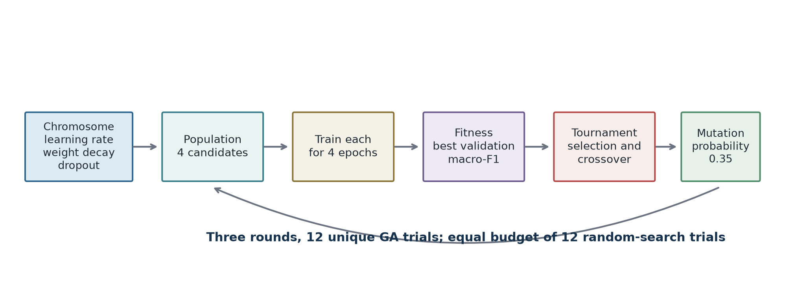

| Stage | GA winner | Random winner | Difference |
|---|---:|---:|---:|
| Proxy validation macro-F1 | 95.2281% | 94.9612% | +0.2669 pp |
| Full validation macro-F1 | 99.6104% | 99.5640% | +0.0464 pp |
| Shared-test macro-F1 | 99.5794% | 99.5745% | +0.0049 pp |

On shared test, GA was uniquely correct on 52 images and random search on 51; exact McNemar
`p = 1.0`. Therefore GA preserved the validation ordering by one image, but the paired evidence
does not demonstrate a statistically distinguishable GA advantage.

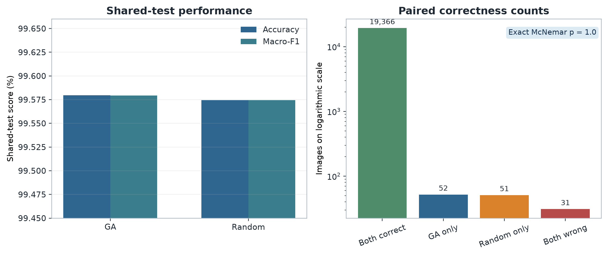

## Repository guide

| Path | Purpose |
|---|---|
| [`src/`](src/) | Training, evaluation, duplicate auditing, Grad-CAM, GA, and split code |
| [`notebooks/`](notebooks/) | Locked Google Colab entrypoints for reportable runs |
| [`config/`](config/) | Label taxonomy and hash-frozen experiment contracts |
| [`research/splits/`](research/splits/) | Fixed split and GA proxy/full-validation manifests |
| [`research/model_results/`](research/model_results/) | Verified metrics, curves, matrices, errors, and Grad-CAM evidence |
| [`research/final_report/figures/`](research/final_report/figures/) | Publication-ready figures used in this README and final report |
| [`tests/`](tests/) | Automated contract, integrity, and pipeline tests |
| [`deliverables/`](deliverables/) | Final English report |
| `archive/` | Local dataset; intentionally excluded from Git |
| `artifacts/` | Large/reproducible local audit outputs; intentionally excluded from Git |

Start with the detailed [Repository and Evidence Guide](docs/REPOSITORY_GUIDE.md).

## Reproduction entrypoints

Local Windows work uses Python 3.10:

```powershell
py -3.10 -m pip install -r requirements.txt
py -3.10 -m pytest -q
```

Main training implementation:

```text
src/train.py
```

Main reportable Colab notebooks:

- [`notebooks/resnet18_26leaf_baseline_colab.ipynb`](notebooks/resnet18_26leaf_baseline_colab.ipynb)
- [`notebooks/smallcnn_26leaf_baseline_colab.ipynb`](notebooks/smallcnn_26leaf_baseline_colab.ipynb)
- [`notebooks/resnet18_lastblock_finetune_colab.ipynb`](notebooks/resnet18_lastblock_finetune_colab.ipynb)
- [`notebooks/resnet18_lastblock_gradcam_colab.ipynb`](notebooks/resnet18_lastblock_gradcam_colab.ipynb)
- [`notebooks/ga_resnet18_lastblock_search_colab.ipynb`](notebooks/ga_resnet18_lastblock_search_colab.ipynb)
- [`notebooks/ga_random_full_confirmation_colab.ipynb`](notebooks/ga_random_full_confirmation_colab.ipynb)
- [`notebooks/ga_random_shared_test_colab.ipynb`](notebooks/ga_random_shared_test_colab.ipynb)

See [Reproducibility Guide](docs/REPRODUCIBILITY.md) before running a notebook. Existing result
directories and Drive checkpoints must not be overwritten.

## Documentation

- [Repository and Evidence Guide](docs/REPOSITORY_GUIDE.md)
- [Dataset Taxonomy](docs/DATASET_TAXONOMY.md)
- [Methods and Validation](docs/METHODS_AND_VALIDATION.md)
- [Experiments and Results](docs/EXPERIMENTS_AND_RESULTS.md)
- [Reproducibility Guide](docs/REPRODUCIBILITY.md)
- [Professor Demonstration Guide](docs/PROFESSOR_DEMO_GUIDE.md)
- [Current Project Plan](PROJECT_PLAN.md)
- [Research Evidence Index](research/README.md)
- [Final English report](deliverables/NNGA_Final_Report_Mehmet_Yusuf_Ocak_Erasmus.docx)

## Scope and limitations

- The dataset contains source/modality confounding: distinguishing MRI from histopathology can be
  easier than learning disease biology.
- The dataset has no patient or scan-series identifiers.
- Known duplicate families are grouped, but unknown visual relatives may remain.
- Some labels are benign/normal, some are malignant subtypes, some are tumor types, and cervical
  labels describe cell morphology. They cannot be converted into one universal binary target
  without unsupported assumptions.
- Parent accuracy measures eight dataset groups, not cancer presence or stage.
- Results are single-dataset, primarily single-seed educational experiments.
- Confidence and Grad-CAM must not be interpreted as clinical certainty or medical localization.

## Dataset and external references

- O. Sai Naren, [Multi Cancer Dataset](https://www.kaggle.com/datasets/obulisainaren/multi-cancer), Kaggle.
- RoupB, [cancer-app](https://github.com/RoupB/cancer-app), inspected as the closest external 26-class reference.
- K. He et al., “Deep Residual Learning for Image Recognition,” CVPR 2016.
- R. R. Selvaraju et al., “Grad-CAM: Visual Explanations from Deep Networks via Gradient-based Localization,” ICCV 2017.
- J. H. Holland, *Adaptation in Natural and Artificial Systems*, 1975.

The complete bibliography and academic discussion are provided in the final report.
