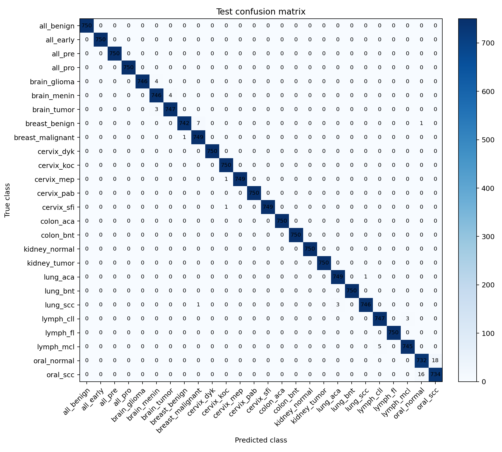
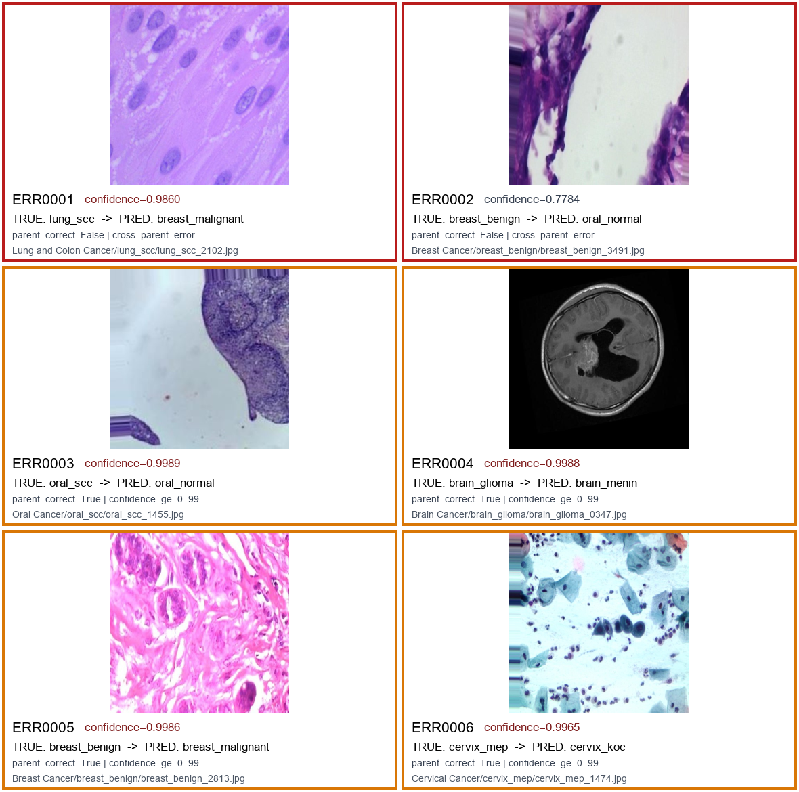
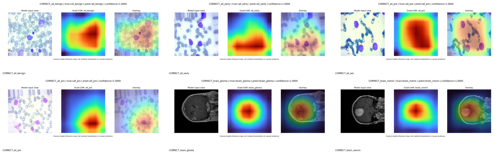
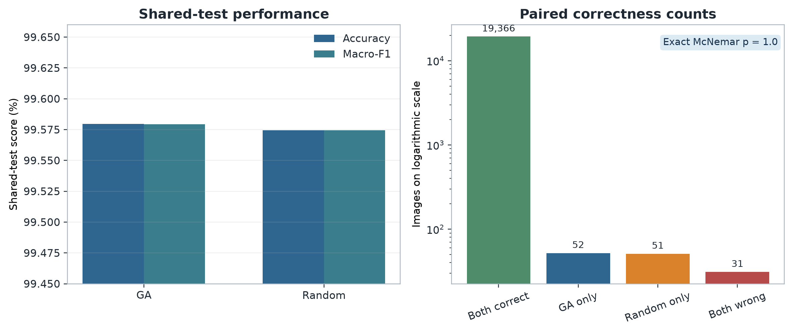

# Experiments and Results

## Shared evaluation contract

All reportable classifiers used the fixed known-family-grouped split:

- train: 91,000 images;
- validation: 19,500 images;
- test: 19,500 images;
- 26 leaves with exactly 3,500/750/750 images each;
- seed 42;
- 224×224 model input;
- checkpoint selection by validation macro-F1.

## Experiment 1 — Frozen-head ResNet18

Purpose: establish a transfer-learning baseline using ImageNet features while training only a new
26-class classifier head.

Configuration:

- pretrained ResNet18;
- frozen convolutional backbone and frozen BatchNorm state;
- AdamW, learning rate 0.001, weight decay 0.0001;
- batch 32, maximum 15 epochs, patience 4.

| Metric | Value |
|---|---:|
| Best epoch | 9 |
| Validation macro-F1 | 91.7727% |
| Test leaf accuracy | 91.3026% |
| Test leaf macro-F1 | 91.2455% |
| Test balanced accuracy | 91.3026% |
| Parent accuracy | 99.7744% |

Evidence: [`research/model_results/resnet18_26leaf_baseline_v1/`](../research/model_results/resnet18_26leaf_baseline_v1/).

## Experiment 2 — SmallCNN from scratch

Purpose: determine how well a compact network learns the dataset without ImageNet pretraining.

Configuration:

- approximately 97,050 trainable parameters;
- all parameters learned from scratch;
- AdamW, learning rate 0.001, weight decay 0.0001;
- batch 32, maximum 25 epochs, patience 5;
- two runtime interruptions safely resumed from atomic checkpoints.

| Metric | Value |
|---|---:|
| Best epoch | 25 |
| Validation macro-F1 | 95.5566% |
| Test leaf accuracy | 95.5846% |
| Test leaf macro-F1 | 95.5916% |
| Parent accuracy | 99.9231% |

On identical test paths, SmallCNN produced 1,351 unique wins over frozen-head ResNet18, while the
ResNet18 baseline produced 516 unique wins.

Evidence: [`research/model_results/smallcnn_26leaf_baseline_v1/`](../research/model_results/smallcnn_26leaf_baseline_v1/).

## Experiment 3 — ResNet18 last-block fine-tuning

Purpose: test whether adapting high-level pretrained features improves the head-only baseline.

Configuration:

- initialized from the validation-selected epoch-9 frozen-head checkpoint;
- new optimizer and training history;
- only `layer4 + fc` trainable: 8,407,066 parameters;
- earlier ResNet blocks frozen;
- AdamW, learning rate 0.0001, weight decay 0.0001;
- batch 32, maximum 12 epochs, patience 4.

| Metric | Value |
|---|---:|
| Best epoch | 11 |
| Validation macro-F1 | 99.5948% |
| Test leaf accuracy | **99.6462%** |
| Test leaf macro-F1 | **99.6462%** |
| Test balanced accuracy | **99.6462%** |
| Parent accuracy | **99.9897%** |
| Leaf errors | 69 |
| Parent errors | 2 |

This model is correct on 1,660 images where the frozen-head baseline is wrong, with 33 reverse
wins. Against SmallCNN, the counts are 832 versus 40.

Evidence: [`research/model_results/resnet18_lastblock_finetune_v1/`](../research/model_results/resnet18_lastblock_finetune_v1/).

## Best-model error analysis

Of 69 leaf errors, 67 stay inside the correct parent group. The largest confusion pair is oral
normal versus oral SCC, contributing 34 errors in both directions. Two errors cross parent groups:

- `lung_scc → breast_malignant`;
- `breast_benign → oral_normal`.

Twenty-three errors have confidence at least 0.90 and seven at least 0.99. High confidence means
strong model preference, not clinical certainty.

Every error is traceable in
[`error_rows.csv`](../research/model_results/resnet18_lastblock_finetune_v1/error_analysis_v1/error_rows.csv)
and the [12 contact sheets](../research/model_results/resnet18_lastblock_finetune_v1/error_analysis_v1/contact_sheets/).

## Grad-CAM audit

The frozen set contained 26 correct controls and 11 errors. All 37 checkpoint predictions were
reproduced before heatmaps were accepted. The audit created 37 panels and seven sheets. Many maps
overlap tissue/cell/organ regions, while some also emphasize borders, blank areas, or visible
source-data artifacts. Similar predicted-class and true-class maps in several errors show why a
heatmap alone cannot establish a medically correct reason.

## Equal-budget GA versus random search

### Proxy search

- 12 unique GA candidates;
- 12 unique random candidates;
- four epochs per candidate;
- 9,100 training and 3,900 validation images;
- no test images or test loader;
- identical model, initialization, seed, and search bounds.

GA winner `GA_G01_C02`:

- learning rate `7.24655842233e-05`;
- weight decay `1.94540732384e-05`;
- dropout `0.461905683802`;
- proxy validation macro-F1 95.2281%.

Random winner `RANDOM_002`:

- learning rate `5.86477956786e-05`;
- weight decay `0.000314775256001`;
- dropout `0.282717237583`;
- proxy validation macro-F1 94.9612%.

The GA winner was already present in generation one; later generations did not improve it.

### Full validation confirmation

Both frozen winners trained on all 91,000 training images and were selected only from the same
19,500 validation images. GA reached 99.6104% validation macro-F1; random reached 99.5640%.

### Shared test

| Result | GA | Random |
|---|---:|---:|
| Leaf accuracy | 99.5795% | 99.5744% |
| Leaf macro-F1 | 99.5794% | 99.5745% |
| Leaf errors | 82 | 83 |
| Parent errors | 3 | 4 |
| Method-only correct | 52 | 51 |

Exact paired McNemar `p = 1.0`. The difference is not statistically distinguishable. Under this
single frozen budget, GA won descriptively by one image, but the experiment does not support a
general claim that GA is superior to random search.

## Result interpretation

The project exceeded its predefined 85% accuracy and macro-F1 target. However, high scores must be
read together with dataset composition. The eight parents are strongly associated with imaging
modality and data source, and the dataset was already augmented. The practical split protects all
known exact and reviewed relations, but unknown near relatives may remain. Results therefore
demonstrate strong performance on this controlled dataset benchmark, not clinical generalization.
