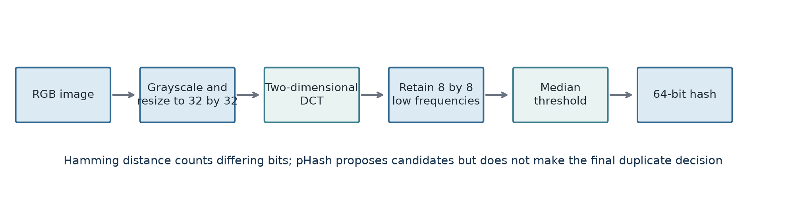
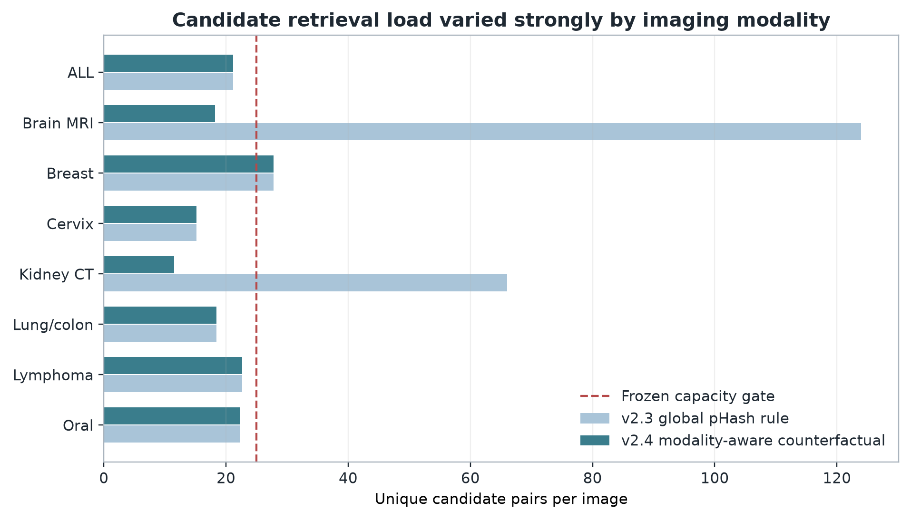

# Methods and Validation

## 1. Dataset integrity audit

The local indexer checks the expected eight top-level folders, discovers all leaf folders, and
excludes two `*.bak.jpg` files. PIL verification opened every accepted image. Image format was
identified from file content rather than extension because 5,000 PNG-encoded files use `.jpg`
names.

## 2. Exact duplicates: SHA-256

SHA-256 is computed from complete file bytes. Two files with the same digest are byte-identical.
This gives high-confidence exact groups, but it cannot find a rotated, brightened, cropped, or
re-encoded version because any byte change alters the digest.

Result: 1,318 exact groups, 2,673 grouped files, and 1,355 redundant copies. No group crosses a
leaf label.

## 3. Perceptual candidate generation

### pHash

The image is converted to grayscale, resized to a small fixed representation, transformed with a
discrete cosine transform (DCT), and summarized from low-frequency coefficients. Thresholding
those coefficients produces a 64-bit signature. Hamming distance counts differing bits: a smaller
distance indicates a more similar global visual structure.

pHash is useful for inexpensive retrieval, but it is not a duplicate verdict. MRI and CT images
share large global anatomical structures and can receive small distances even when they are
independent slices. Histopathology transforms can behave differently. The project therefore did
not use one global pHash threshold as the final family rule.

### Robust ResNet18 retrieval

An ImageNet-pretrained ResNet18 converts each image into a feature descriptor. Four views were
used to reduce sensitivity to brightness and framing: raw, autocontrast, raw multi-crop, and
autocontrast multi-crop. Cosine similarity retrieves only a bounded number of close candidates,
avoiding an infeasible all-pairs expensive comparison.

## 4. Pair verification measurements

Candidate pairs were examined with complementary methods:

- **ORB:** detects repeatable local corners/keypoints and builds binary descriptors around them.
  It provides tentative correspondences between two images.
- **RANSAC:** repeatedly estimates an affine transform from subsets of ORB matches. Matches that
  agree with one common geometric transform are inliers; unrelated lookalikes usually produce few
  consistent inliers.
- **Phase correlation:** measures translation from the phase difference between Fourier spectra.
  It is useful when two images differ mainly by horizontal or vertical displacement.
- **ECC:** iteratively finds a geometric warp maximizing enhanced correlation coefficient. It is
  helpful for low-texture MRI/CT/Pap images where ORB can return few reliable points.
- **SSIM:** compares local luminance, contrast, and structural patterns after alignment. Values
  closer to one indicate stronger structural agreement.
- **NMI:** measures shared intensity information and tolerates some intensity remapping. It is a
  supporting measurement rather than a standalone duplicate decision.
- **Correlation:** measures whether aligned pixel intensities vary together. High correlation
  supports similarity but can also arise from common backgrounds.

The measurements are intentionally complementary. Geometry, structure, and intensity evidence
are considered together; uncertainty is allowed rather than forcing every pair into duplicate or
independent.

## 5. Development and protected holdout

The duplicate-rule development data and holdout data were separated by source paths. The rule was
frozen before opening holdout evidence. On 671 holdout pairs it recovered 547/547 same-source
references, correctly decided 120/124 independent pairs, and conservatively abstained on four
difficult MRI/CT independent pairs. Decided-pair accuracy was 100%; coverage treating abstention
as unresolved was 99.40%.

These are duplicate-audit results, not cancer-classification metrics.

## 6. Full-scale retrieval lessons

The first full v2.3 retrieval generated 4,621,932 candidates, or 35.553 candidates per image,
above the frozen operational limit of 25. Brain MRI and kidney CT produced 98.3% of pHash-only
load, showing why one global pHash channel was inappropriate.

The modality-aware v2.4 counterfactual reduced load to 2,491,553 pairs (19.166/image), preserved
all exact and controlled references, and recovered **95.65%** of the initial natural reference set.
Later prospective audits still found same-2D relatives outside bounded candidate rules. Rather
than repeatedly tune against newly revealed misses, the project froze all accumulated evidence
and moved to a transparent known-family-grouped split.

## 7. Fixed practical leakage-reduced split

Every exact group and frozen reviewed link was merged into a transitive connected component. If
A is linked to B and B to C, A–B–C forms one component even without a direct A–C edge. A component
is assigned as one unit and cannot cross partitions.

Assignment is exactly stratified by all 26 leaves:

| Partition | Per leaf | Total |
|---|---:|---:|
| Train | 3,500 | 91,000 |
| Validation | 750 | 19,500 |
| Test | 750 | 19,500 |

Verified invariants:

- every accepted image appears exactly once;
- all 26 leaves appear in every partition;
- exact per-leaf counts hold;
- zero exact groups cross a partition;
- zero reviewed links cross a partition;
- zero known components cross a partition;
- rerunning with seed 42 reproduces the same manifest hash.

## 8. Neural-network training protocol

The trainer loads the fixed manifest and refuses a different SHA-256. Training updates weights on
the train partition. Validation macro-F1 selects checkpoints and drives early stopping. Test is
used only after the run is finalized.

For every reportable test evaluation, the pipeline saves:

- accuracy, macro-F1, and balanced accuracy;
- per-class precision, recall, and F1;
- leaf and parent confusion matrices;
- one probability vector and prediction record per test image;
- learning curves, run configuration, and split provenance;
- artifact hashes for independent verification.

## 9. Transfer learning and fine-tuning

The first ResNet18 experiment used ImageNet weights while freezing the feature-extraction
backbone. Only the new 26-output fully connected head learned from this dataset. The best model
then initialized a separate fine-tuning experiment in which only `layer4 + fc` was trainable.
Earlier layers stayed frozen to preserve generic edges, textures, and shapes. The optimizer and
history were restarted, because this was a new experiment rather than resuming an interrupted
run. A lower learning rate reduced the risk of destroying pretrained representations.

## 10. Grad-CAM protocol

Grad-CAM backpropagates a target-class score into the final convolutional layer, averages the
gradients into channel weights, combines the activation maps, applies ReLU, and upsamples the
result over the input. Samples were frozen before heatmaps were inspected to avoid cherry-picking.

## 11. Genetic algorithm protocol

Each candidate is a three-gene vector: learning rate, weight decay, and dropout. GA candidates
undergo selection, recombination, mutation, duplicate rejection, and bounded repair. Random search
samples the identical bounds. Both methods receive the same number of unique trials, starting
checkpoint, data, seed, and four-epoch proxy budget. Test data is absent during search and
full-validation confirmation.

This design tests whether GA provides an advantage under one controlled budget. It does not assume
that GA must win or that later generations must monotonically improve.
